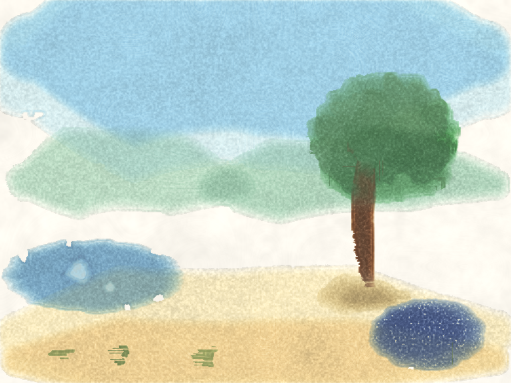
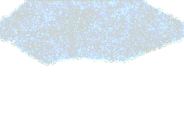
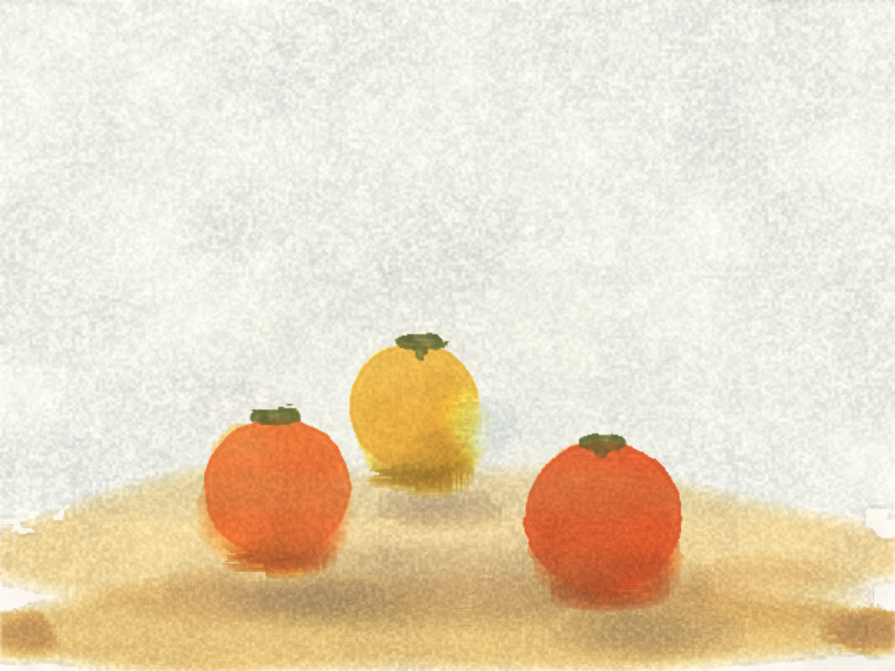
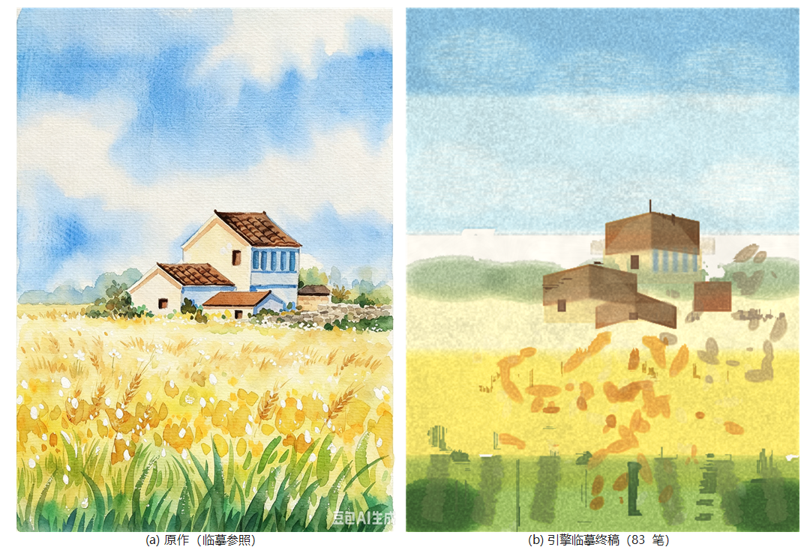
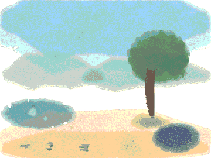

# watercolor-ai（暂名）

> 不是"生成一张水彩画"，而是**像人一样画一张水彩画**：从构图开始，一笔一笔、一层一层地画完——水在纸上自己干、自己渗、自己长出边缘。

**一句话定位**：agent 水彩画家 —— LLM 管意图，介质引擎管水，时间线管叙事。

## 作品与作画过程

先看作品，再读理念。三幅画全部由仓库脚本一键复现（`npm run demo` / `agent` / `copy`）。

### 《树与池塘》· 32 笔手绘全景 · vision 8.8/10





### 《三个柿子》· LLM 仅凭 stroke 协议写出的 75 笔静物 · vision 闭环 11 版定稿




### 《乡村田野》· 83 笔临摹，笔序即叙事 · 6 轮闭环 5.0 → 6.5




### 水彩的美是时间函数 · 10 秒真实干燥



## 为什么存在

- diffusion 强在采样，但过程不可见、不可干预、不可复现；
- 水彩引擎（Rebelle / Expresii / Fresco）强在介质，但不会自己构图，只等一只手；
- LLM 强在意图（构图、笔序、色彩理论、技法），但不知道水会怎么流。

我们做**除法**：三权分立，各干各最擅长的事。这个组合落在所有现有产品的空象限里：**过程可见 + 介质真实 + 自主创作**。

## 核心信念

1. **水彩的美是时间函数**。水痕是湿区边缘蒸发时的回流，毛边是颜料随水渗进纸纤维，颗粒聚集是重颜料在纸谷里沉降。这些不是形状，是过程。
2. **介质必须真实，但不必物理**。观众认的是"感知签名"不是方程。引擎职责：湿扩散、边缘沉积、回流开花、颗粒聚集、干燥时间线。
3. **过程即产品**。作画过程本身就是内容：可观看、可暂停、可提问、可回放。

## 资产

- **画 = 程序**：笔触列表是这幅画的源代码，引擎是解释器。同一张画可以换纸、换倾斜、重放干燥过程、在 8K 重渲染。
- **作画即内容**：真实的干燥时间线让"进化动图"不再是几张图的轮播，而是时间流逝本身。

## 当前状态（v0.3.0 · 最小发布存档版）

> 2026-08-17 收工存档。恢复路径见文末「下一步」。

介质引擎与接入层原型都已交付，纯 JS + typed array，**零依赖**，Node 可跑（浏览器兼容设计）：

- **介质引擎五工件 + 升级 M0-M5**：湿扩散、边缘沉积线、回流开花、颗粒聚集、干燥时间线；M0 位级确定与性能 → M1 各向异性纸纹（σ 钉扎/κ 渗透）→ M2 岸线算子与宏观破圆 → M3 bloom 曲率圆瓣化 → M4 盐花/硬边/纸纹预设/重力淌色/lift → M5 颜料物性四字段（湿中混色/分离/再湿率）。全景 vision **2.0 → 8.8**
- **双颜色系统**：RGB 三通道 KM（基线）与 **16 波段光谱 KM**（400-700nm，每支颜料一条光谱，CIE 1931 + D65 → XYZ → sRGB）。全强度 24 色平均 ΔE：RGB 5.5 → **光谱 3.2**；色卡视觉 7.2 → 8.5。切换：`COLOR_SYSTEM=spectral node demo/render-demo.js`
- **笔刷动力学 v2.0**：水库 / N 毛模型 / 分桶沉积 / 一笔内时间——干笔飞白、毛尖折线、干皴硬角成立
- **stroke 协议 v0.3 + 端到端实测**：LLM 只通过协议画出 75 笔静物《三个柿子》（vision 闭环 11 版定稿）；83 笔临摹《乡村田野》（poly 原语 + 全记录运行器，6 轮闭环 5.0→6.5 遇平台期）
- **反思与论文**：平台期五轮病灶推演（`docs/reflection-painter-loop.md`）→ 下一步锚定 Oracle 1；成果论文稿 `paper/paper.md`（12 图，中英摘要）
- **回归之锚**（全部可复现）：`demo/color-metrics.js`（色彩）、`demo/color-chart.js`（色卡）、`demo/effects.js`（技法面板）、`demo/render-demo.js`（全景）、`demo/showcase.js`（15 件能力集）、`out/baseline-m0/`（M0 基线快照）

### 诚实评分（vision 独立评审）

| 对象 | 分数 | 说明 |
|---|---|---|
| 引擎全景（M1-M5 后） | 7.5 → 8.5 → **8.8/10** | M5 混色轮 8.8 全场新高 |
| 回流开花特写 | 6.5-7/10 | 闭环深色蕾丝 + 浅色水渍心成立 |
| 24 色卡 | RGB 7.2 → 光谱 **8.5/10** | 约 17-18 支可盲认 |
| 干笔（brush v2.0） | 7/10 | 前段真干透、尾断飞白成立 |
| 《三个柿子》（agent 纯协议） | 11 版闭环定稿 | 75 笔，LLM 不碰引擎不偷看渲染 |
| 《乡村田野》临摹 | 5.0 → 5.5 → 6.0 → 6.2 → **6.5 平台** | 差在结构细节笔法——反思小论文的病历 |
| Open-Watercolor-Sim（对照） | 2.5-3/10 | 官方 demo "带颜色的雾" |

门槛解读：**"水是真的"已过大半**；**"手会画画"已起步**（agent 能闭环改到定稿）；**瓶颈已从介质层转移到笔触设计与意图层**——平台期的病灶已推演清楚，下一步是 Oracle 1（可画性验证），见 `docs/reflection-painter-loop.md` 终局。

## 项目史

所作之事，尽录于 **`chronicle/`**（平实开发日志，六个阶段文件 + 参考速查）：探测与引擎 → 回流与笔触 → 色卡与 KM → 光谱与分层 → 参数/评分/bug 速查 → **接入实测与反思**。

## 快速开始

```bash
npm test                   # 冒烟：完整渲染一遍
node demo/render-demo.js   # 全景《树与池塘》→ out/demo_final.png + 两个动图
node demo/agent-paint.js   # 《三个柿子》agent 定稿 → out/agent_still_life.png + 动图
node demo/copy-paint.js    # 《乡村田野》83 笔临摹 → out/copy-frames/ + 终稿 + 动图
node demo/effects.js       # 8 格效果测试面板
node demo/color-chart.js   # 24 色卡三栏（RGB | 光谱 | 平涂参照）
node demo/color-metrics.js # CIELAB 双系统对照（色彩回归基准）
node demo/compare.js       # 引擎 vs 平涂对比图
node demo/showcase.js      # 15 件能力展示集 → out/showcase/
node demo/crop.js          # 回流开花 / 颗粒特写

# 光谱颜色系统（16 通道，慢约 2.7 倍）：
#   PowerShell: $env:COLOR_SYSTEM="spectral"; node demo/render-demo.js
#   或 npm run demo:spectral（cmd）
```

## 仓库布局

```
├── src/        # 引擎源码: core(介质) / color(颜色) / brush(笔触) / paper(纸纹) / io(PNG·GIF) / studio(装配)
├── demo/       # 场景与运行器: 全景 / 三柿子 / 乡村田野 / 色卡 / 技法面板 / 探针与测试
├── assets/     # README 展示用预览图(GIF 时序预览,由 demo/make-readme-gifs.py 生成)
├── docs/       # 规格与范式文档 + COORDINATION.md(双会话协作契约,已归档)
├── research/   # 调研: papers(论文) / data(标准数据) / notes(精读) / probes(OWS 探测与抓取残料)
├── chronicle/  # 项目史(六个阶段开发日志)
├── paper/      # 成果论文源稿 + 12 幅配图 + 导出脚本
└── out/        # 渲染产物(不入库、可重新生成;out/README.md 是产物索引;baseline-m0/ 例外入库)
```

- `docs/paradigm.md` — 范式：从对话中沉淀的认知精华
- `docs/architecture.md` — **分层架构与升级缝（松耦合升级的正式规格）**
- `docs/engine.md` — 强引擎规格：五个工件 + **stroke 协议 v0.3** + 工件缺口 backlog
- `docs/engine-js.md` — JS 引擎实现说明（数据结构、管线、bloom 算子、参数表、已知问题）
- `docs/watercolor_engine_spec.md` — Hobbs/Curtis 算法规格（研究产出，公式有出处）
- `docs/agent-loop.md` — 接入层：agent 笔序 + vision 阶段批评（Phase 1）
- `docs/reflection-painter-loop.md` — **反思小论文**：平台期五轮病灶推演与处方——下一步的裁决依据
- `docs/taste.md` — 品味观与手文件：品味不生成、被继承被选择；人是唯一神谕；产品四档（看/画/同画/传）
- `docs/teaching-mvp.md` — Phase 1 第一刀：教学回放 MVP 的范围切割（教不会画的）
- `docs/paintability.md` — 可画性基准：十基元电池 + oracle 下限——先证引擎可画，再谈 AI
- `docs/paintable-representation.md` — 可绘制表征 Z + 逆水彩分解——画家操作的不是对象
- `docs/lessons.md` — dsh-studio 实战教训（本项目的需求输入）
- `docs/predecessors.md` — 介质引擎/流体求解前辈调研（Tyler Hobbs、Rebelle、MoXi 等）
- `docs/predecessors-agents.md` — agent 画家论文册（Intelli-Paint、Inverse Painting）
- `docs/roadmap.md` — 尖峰 → 接入 → 产品化
- `docs/COORDINATION.md` — 双会话协作契约（目录所有权/提交纪律/接口接触点；已随合并存档）
- `demo/` — 场景与运行器（`scene.js` 全景、`agent-scene.js` 三柿子、`copy-scene.js` 乡村田野；`*-probe.js`/`*-test.js` 数值探针与冒烟测试）
- `research/probes/` — Open-Watercolor-Sim 探测全记录（`ows/` + `OWS-评估.md`）与抓取/提取脚本
- `research/` — 论文文本与精读、CIE 1931/D65 标准数据（PDF 原件按惯例仅本地）
- `paper/` — 成果论文源稿 + 12 幅配图 + 导出脚本
- `out/` — 渲染产物（见 `out/README.md` 索引；`out/baseline-m0/` 为 M0 位级确定基线快照，例外入库）

## 关联项目

- dsh-sight — 眼睛（vision 工具）
- dsh-studio — 手（SVG 前身；教训见 `docs/lessons.md`）
- DeepSeek Harness — 宿主运行时

## 下一步（存档后恢复路径）

1. 读 `chronicle/06-接入实测与反思.md` 与 `docs/reflection-painter-loop.md` 终局（病灶 / 处方 / 未决清单）。
2. **Oracle 1**：可微平面笔触拟合《乡村田野》——回答"表示够不够"，三分支裁决（见 `docs/paintability.md`、`docs/paintable-representation.md`）。
3. 可画性十基元电池出第一版成绩卡（agent 循环上线前的硬前置）。
4. 之后回到 Phase 1 接入：stroke 协议定稿、dsh-studio 循环骨架移植、vision 阶段批评接入（`docs/agent-loop.md`）。
