# Watercolor-AI：意图、介质与时间三权分立的自主水彩绘画系统

> 项目代号 watercolor-ai · 本文档为成果论文（Markdown 源稿），配图位于 `figures/`。
> 作者与单位信息占位：定稿前请在标题下补充（作者名 · 机构 · 日期）。
> 导出 PDF 说明见 `paper/README.md`。

---

## 摘要

本文提出并实现了一个自主水彩绘画系统 Watercolor-AI。与"生成一张水彩画"的扩散模型路线和"等一只手来画"的水彩引擎路线不同，本系统把作画拆成三个互不越权的角色：语言模型负责意图（构图、笔序、色彩与技法，只输出结构化的笔触指令），介质引擎负责水（湿扩散、边缘沉积、回流开花、颗粒聚集与干燥时间线的忠实渲染），时间线负责叙事（每一笔带时间戳，湿区真实蒸发干燥，作画过程本身成为可观看的产品），并以视觉模型的阶段批评构成"画—看—批—改"的闭环。介质引擎以"感知签名"而非全物理模拟为设计目标：纯 JavaScript 实现、零运行时依赖，在 640×480 网格上运行九步管线，覆盖水彩的五个标志性视觉签名；颜色系统采用 Kubelka-Munk 光学模型，并实现 RGB 三通道与 16 波段光谱双实现，24 色全强度平均色差 ΔE 由 5.5 降至 3.2。系统在两条完整的作画序列上得到验证：由意图层经 stroke 协议书写的 75 笔静物《三个柿子》，以及 83 笔临摹《乡村田野》。独立视觉评审的全景评分从最初的 2.0/10 提升到 8.8/10，显著优于作为对照基准的开源引擎 Open-Watercolor-Sim（官方 demo 2.5/10）。实验结果支持本文的核心论点：**水彩的美是时间函数，而"过程可见 + 介质真实 + 自主创作"是当前所有生成式绘画产品的空象限。**

**关键词**：非真实感渲染；水彩模拟；大语言模型智能体；感知签名；Kubelka-Munk；作画过程可视化

---

## Abstract

We present Watercolor-AI, an autonomous watercolor painting system built on a strict division of labor. Unlike diffusion-based approaches (opaque processes) and watercolor engines (which wait for a human hand), our system assigns painting to three non-overlapping roles: a language model owns *intent* and emits only structured stroke commands; a medium engine owns *water* and faithfully renders wet diffusion, edge darkening, backruns (cauliflower blooms), granulation, and a real drying timeline; and the timeline owns *narrative*, making the painting process itself a watchable product. A vision model closes the loop with stage-wise critique ("paint–look–criticize–revise"). The medium engine targets *perceptual signatures* rather than full physics: implemented in dependency-free JavaScript, it runs a nine-stage pipeline on a 640×480 grid covering the five signature watercolor artifacts. The color system uses the Kubelka–Munk model with interchangeable RGB (3-channel) and spectral (16-band, 400–700 nm) implementations, reducing the mean ΔE of 24 pigments at full strength from 5.5 to 3.2. The system is validated on two complete painting sequences: a 75-stroke still life *Three Persimmons* authored purely through the stroke protocol, and an 83-stroke copy of a rural-field reference painting. Independent vision-based scoring improved from 2.0/10 to 8.8/10 for full scenes, far above the open-source baseline Open-Watercolor-Sim (official demo 2.5/10). The results support our central claim: *the beauty of watercolor is a function of time, and "visible process + faithful medium + autonomous creation" is an empty quadrant among current generative painting products.*

**Keywords**: non-photorealistic rendering; watercolor simulation; LLM agents; perceptual signatures; Kubelka–Munk; painting-process visualization

---

## 1 引言

### 1.1 三条路线与一个空象限

今天的"AI 画画"可以大致归为三条路线，每一条都在自己最强的维度上做到了极致，也都在另一个维度上结构性缺席：

- **扩散模型**（diffusion）强在采样：一步出图、细节精美。但它的过程不可见、不可干预、不可复现——观众看到的永远是结果，看不到画是怎么发生的。
- **水彩引擎**（Rebelle、Expresii、Fresco 等）强在介质：水痕、毛边、颗粒聚集逼真可信。但它们不会构图、不会选择笔序——它们是一群极好的手，永远在等一只手来指挥。
- **语言模型 + 矢量图形**（本项目的直接前身 dsh-studio 即属此类）强在意图：构图、笔序、色彩理论都可由 LLM 规划。但它不知道水会怎么流，输出天花板是"构图正确的几何拼贴"——评分达标却平庸。

三者各自缺席的维度恰好构成一个空象限：**过程可见 + 介质真实 + 自主创作**。本文工作的全部动机，就是站进这个象限。

### 1.2 核心论点

1. **水彩的美是时间函数。** 水痕是湿区边缘蒸发时的回流沉积，毛边是颜料随水渗进纸纤维，颗粒聚集是重颜料在纸谷里沉降。这些不是形状，是过程。静态图像里不存在时间，因此任何"静态图像生成器"画的水彩，天花板都是假水彩。
2. **介质必须真实，但不必物理。** 观众认的是"感知签名"而非方程——Fresco 与 Procreate 已经证明这条路的商业成立。引擎的职责是让五个签名（湿扩散、边缘沉积、回流开花、颗粒聚集、干燥时间线）可信地发生，而不是求解 Navier-Stokes。
3. **过程即产品。** 真实干燥时间线让"进化动图"不再是几张图的轮播，而是时间流逝本身。观众第一次看见水痕"长出来"，就不会再问"这是不是滤镜"。

### 1.3 本文贡献

1. **三权分立架构**（§3.1）：LLM 管意图、介质引擎管水、时间线管叙事、vision 管反馈，四者通过 stroke 协议解耦协作；
2. **感知签名介质引擎**（§3.3–§3.7）：纯 JS、零依赖、通道数泛化的九步管线，实现五个签名工件及十余个扩展工件（岸线三层结构、各向异性纸纹、宏观破圆、重力淌色、盐花、洗色堆挤、湿中混色等），全程以独立视觉评审为验收锚；
3. **双颜色系统**（§3.4）：KM 光学模型 + RGB/光谱双实现，CIE 1931 观察者与 D65 光源，24 支颜料的程序化光谱，全强度平均 ΔE 由 5.5 降至 3.2；
4. **stroke 协议与"画 = 程序"资产观**（§3.2）：一幅画是一份有序的笔触指令列表——画的源代码，可重放、可改参数重渲染、可 8K 再渲染；
5. **两条端到端作画序列**（§5）：75 笔自主静物与 83 笔临摹，覆盖"意图层书写 → 引擎渲染 → 视觉批评 → 改笔"的完整闭环，全部过程帧与逐笔快照公开可查。

---

## 2 相关工作

### 2.1 水彩模拟与渲染

Curtis 等人在 SIGGRAPH 1997 发表的 *Computer-Generated Watercolor*[1] 是介质引擎的祖论文：浅水层模型、Kubelka-Munk 光学复合、纸高场驱动的沉积偏置，以及回流（backrun）的毛细容量机制，构成了此后二十余年水彩渲染的基本语言。Small[3] 与 MoXi[5] 分别从颜料扩散与吸收纸墨扩散的角度推进了介质模拟。Bousseau 等人[6][7] 把水彩渲染带入交互与视频领域，并明确警示"扩散必然破坏时域相干"——这一警示被本文收入诚实清单（§6.2）。Montesdeoca 等人[8][9] 的姊妹篇给出边缘加深、granulation 与岸线效果的轻量实现路线，是本文岸线算子（§3.6, M2）与颗粒聚集实现的重要对照。Wetbrush[10] 与 DiVerdi 等人[11] 代表工业级笔刷路线：前者在 GPU 上以 FLIP/PIC 粒子模拟毛刷与油彩，后者给出虚拟鬃毛笔的工业实现。Hobbs 的程序化水彩随笔[13] 与 Zheng 等人的范例笔刷[12] 则代表"轻量启发式 + 风格迁移"的另一端。

### 2.2 生成式绘画与 LLM 智能体

扩散模型[17][18] 在图像生成上取得了广泛成功，但其过程不可见、不可干预、不可复现，与本工作的目标正交。文本到 SVG / 程序化绘画方向（含本项目前身 dsh-studio）证明了 LLM 的构图与笔序能力，也暴露了其天花板：批评粒度（主题级）与执行粒度（路径级）不匹配，输出是"构图正确的几何拼贴"[19]。

### 2.3 开源水彩引擎探测

项目启动之初，我们对 8 个开源水彩方案做了系统探测，并实测了唯一可被 agent 无头驱动的候选 Open-Watercolor-Sim[20]（Taichi GPU 内核、Eulerian 网格、确定性步进、Apache-2.0，其内核参考 Stam 稳定流体[14] 与 Curtis[1]）。探测结论：**机制可驱动，质量不过门槛**——官方 demo 视觉评审 2.5/10（"带颜色的雾"），我方调参到极限仅 3.0/10；cauliflower 四象限参数实验证实其回流机制结构性缺失，参数救不了内核，修补等于重写其 Taichi 内核。因此我们选择自研 JS 引擎，OWS 保留作并行渲染对照（§4.4）。

**差距**：介质真实（引擎）、自主创作（LLM）、过程可见（时间线）三者从未在同一系统内合流——这正是本文工作填补的空白。

---

## 3 系统设计

### 3.1 三权分立架构

系统由四个角色构成一个闭环（图 1）：

- **意图层（LLM）**：负责构图、笔序、色彩理论与技法选择，只通过 stroke 协议输出结构化笔触指令，不产生像素；
- **介质引擎（core）**：忠实渲染每一笔的水行为。水痕、毛边、颗粒是引擎的职责，模型不再伪造；
- **时间线**：每一笔带时间戳，湿区按真实蒸发速率干燥，水痕在回放中"长出来"；
- **眼睛（vision）**：每阶段对真实画布（而非模型意图）做局部批评，agent 据此决定下一笔或撤一笔。

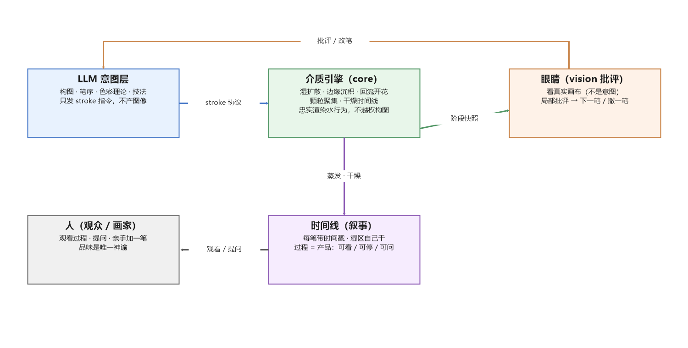

图 1　系统分工：LLM 管意图、引擎管水、时间线管叙事、vision 管批评，四者经 stroke 协议闭环。

这一设计的直接来源是 dsh-studio 的实战教训：SVG 白名单锁死质感、rubric 五维全是技术正确性、批评粒度与执行粒度不匹配。**把介质从模型手里拿走交给引擎**之后，模型只需负责它擅长的意图，且 stroke 级的错误可局部撤笔，无需整幅重画。

### 3.2 画 = 程序：stroke 协议

一幅画被定义为一组有序的 stroke 指令（JSON），即这幅画的源代码。协议 v0.2 的设计原则：颜料名优先（LLM 说"群青"比说 hex 自然，且名字携带库中物性）；brush/motion 字段承载笔的身份与运笔因果；全部字段有默认值，模型只写它想控制的。笔触类型初集见 表 1，协议示例如下：

```json
{
  "strokes": [
    { "t": 0,      "type": "wet-wash", "region": "paper-upper-half",
      "pigment": { "name": "群青", "amount": 0.5 }, "water": 0.8,
      "brush": { "shape": "flat", "width": 60, "load": 0.8 },
      "motion": { "speed": 0.3, "pressure": [0.2, 1.0, 0.1] } },
    { "t": 24000,  "type": "dry-brush", "path": "M 320 400 C 380 380, 420 430, 480 410",
      "pigment": { "name": "深绿", "amount": 0.4 }, "water": 0.15,
      "motion": { "speed": 0.7, "pressure": [0.1, 0.8, 0.0] } }
  ],
  "paper": { "texture": "cold-press", "size": [1280, 960], "tilt": 0 }
}
```

表 1　stroke 协议笔触类型初集

| type | 语义 | 引擎机制 |
|---|---|---|
| `wet-wash` | 湿铺（含有机 blob 与 ribbon 条带扫笔） | 沉积 + 湿扩散 + 掩码扩张 |
| `glaze` | 罩染（透明叠色） | KM 光学复合 |
| `cover` | 覆盖湿铺（大面积底） | 大区沉积 + 软边 |
| `poly` | 多边形原语（屋顶、墙、窗） | hard 轮廓 + 顶点沉积 |
| `dry-brush` | 干皴（泪滴戳 + 飞白） | 纸齿断裂 + 颗粒 |
| `spatter` | 溅点（幂律散布） | 随机粒径沉积 |
| `re-wet` | 再润湿（滴清水触发回流） | pushPigmentRadial 显式搬运 |
| `lift` | 洗色（提亮 / 撤笔） | P/D 按比例移除 + 方向堆挤 |
| `salt` | 盐花 | 星形吸色（M4 交付） |

"画 = 程序"带来三层资产价值：同一份笔触列表可换纸、换倾斜、重放干燥过程、在更高分辨率重渲染；作画过程天然可录制、可回放；笔触列表本身就是可分享、可 remix 的 recipe。

### 3.3 介质引擎：九步管线与五个感知签名

引擎在半分辨率网格（640×480）上以 Float32Array 模拟，双线性上采样回 1280×960 输出（水彩是软的，模糊本就在其签名里）。每步执行九段管线：流场（压力梯度 + 重力 + 纸纹扰动）→ 水半拉格朗日平流与扩散 → 掩码扩张（清水前锋）→ 颜料半拉格朗日平流（pigAdv 0.65，颜料滞后于水）→ 沉积（纸谷偏置，Curtis 式 1−σ·h）→ 前缘沉积 → 湿区边缘加深（仅内侧边带，外侧白纸不染灰）→ 蒸发（边缘先干 + 咖啡环拉取）→ 冻结。核心场为水量 W、溶液颜料 P（存 K·d）、沉积颜料 D 与质量 d、湿掩码 M、流速 u、纸场 H/C/G/F。

引擎对五个感知签名的实现与验收见 表 2。

表 2　五个感知签名工件：机制与验收

| # | 工件 | 机制要点 | 验收结果 |
|---|---|---|---|
| 1 | 湿扩散 | 半拉格朗日平流 + 扩散 + 掩码扩张 | 湿铺 10 秒内自然晕开 |
| 2 | 边缘沉积 | 渲染侧内侧边带（mask − blur）+ 纸纹调制 | 干皴一笔"毛边 + 深边"同时成立 |
| 3 | 回流开花 | 显式质量守恒搬运（6 版迭代后定稿）+ 解析闭环 | 特写 6.5–7.0/10，闭环蕾丝 + 浅色水渍心成立 |
| 4 | 颗粒聚集 | 细颗粒 × 纸谷偏置 × 每颜料颗粒度 | 细腻颜料与重颗粒颜料肉眼可分 |
| 5 | 干燥时间线 | 逐笔时间戳 + 蒸发 + 冻结 + 阶段快照 | 10 秒回放中水痕"长出来" |

回流开花是引擎迭代最深的算子：六版方案依次排除了径向高斯推挤（位移剖面解压）、压缩式剖面（采样穿过中心）、径向钳位取样（均匀场插值不守恒）、只搬溶液（滴落时 65% 颜料已沉积）与单格取整（像素阶梯）等失败路线，最终收敛到**显式质量守恒搬运 + 双线性溅射 + 解析闭环增强**。关键经验：回流花边的灵魂是被"输运"出去的颜料，而不是被冲淡的中心；闭环由构造保证，而非由噪声碰运气。

### 3.4 颜色系统：KM 与光谱革命

颜色线经历两次革命：

1. **指数吸收 → KM 复合**：初版按 exp(−absorb·(1−rgb)) 渲染，通道吸收比锁死为 (1−r)/(1−g)，饱和色色相最大偏差 0.59（深红渲染成泥粉棕）。改用 Kubelka-Munk 单常数模型（每通道存 K·d，K=(1−R)²/2R），渲染端逐通道 coth 复合，最大偏差降至 0.102，色卡视觉评分 7.2/10。
2. **RGB 三通道 → 16 波段光谱**：三通道常数表达不了镉红的火感、酞菁的透明度、群青的颗粒分色——颜料没有"身份"。光谱实现以 CIE 1931 2° 观察者（1 nm）+ D65 光源数据为基，取 400–700 nm 每 20 nm 一个波段，24 支颜料各配一条按颜料家族立形（镉类陡峭边、群青长波回升、酞菁绿肩、铁氧化物平滑上升……）并经坐标下降拟合到标称色的程序化光谱（平均拟合 ΔE 1.9）。模拟端逐通道存 K·d，渲染端逐波段 KM → XYZ → sRGB。

表 4 汇总了双系统的量化与视觉指标。实现上，引擎**不知道通道的含义**：它只搬运每通道 K·d 与质量 d，颜色革命未改引擎一行——这是 §3.5 分层架构的直接验证。

### 3.5 分层架构与升级缝

代码按六部组织（图 2）：core（介质核心）、color（颜色系统）、brush（笔触）、paper（纸纹）、io（PNG/GIF 编码）、studio（编排装配）。三处显式升级缝使子系统可**松耦合、并行、异步**升级：`ColorSystem` 接口（换颜色模型不动引擎与笔触，`COLOR_SYSTEM=spectral` 一键切换）、`StrokePainter`（换运笔不动引擎）、`Studio`（demo 与 agent 层的唯一依赖）。依赖方向禁环：`studio → {core, color, brush}`；`demo → {studio, io, color}`；`core/brush → paper`。

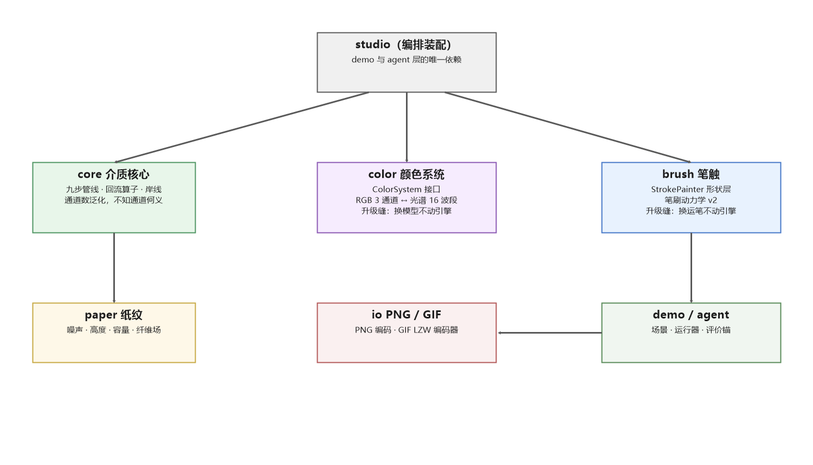

图 2　六部分层架构：core/color/brush 可独立异步升级，demo 与 agent 只依赖 studio 稳定接口。

在并行开发实践中，该架构经受了三条线（brush v2 / 介质 M0–M5 / 色彩线）在同一工作区并行提交、线性零冲突的检验。

### 3.6 介质核心升级（M1–M5）

在五个签名工件交付后，针对"为什么都是圆的""水线像描边""没有重力"等评审批评，介质核心进行了五轮升级（表 3）。其中收益密度最高的是 M2 岸线算子：以蒸发驱动的向内输运同时治愈咖啡环、水洼成环、炸花 bloom 与颜料分离雏形——"一鱼四吃"；而 M3 把 bloom 的形状生成（角度噪声）替换为曲率驱动的半径剖面演化 `R ← R + ΔR·(v0 + vc·(κ0 − κ) + vN·noise) + D·R''`，圆润由构造保证，颜料搬运一行未动。

表 3　介质核心升级 M1–M5

| 编号 | 内容 | 关键机制 | 评审 |
|---|---|---|---|
| M1 | 各向异性纸纹 | 纤维方向场 Tx/Ty + σ 钉扎 + κ 变渗透率（MoXi 主机制） | 7.5/10 |
| M2 | 岸线算子 | 蒸发驱动向内输运：深色水线 + 近岸透明带 + 外侧浅线，切线断环 | 8.5/10 |
| M2.2–M2.4 | 宏观破圆 + bloom rim | σ 宏观分量 + 沉积后侵蚀；岸线驱动干燥前沿成环 | 定稿 |
| M3 | bloom 曲率驱动 | 半径剖面曲率演化 + 谷地板，花瓣圆润化 | 定稿 |
| M4 | 廉价五件 | 盐花 / 硬边 / 纸纹三档 / 重力淌色 / 洗色堆挤 | 逐件验收 |
| M5 | 颜料物性四字段 | 质量 / 沉降 / 容纸度 / 再湿率 → 湿中混色、粒重分离 | 8.8/10 全场新高 |

同时，笔触层完成笔刷动力学 v2（发射器 + N 毛模型 + 水库状态机 + 分桶沉积），以数值探针（守恒、单调、确定性）与 vision 终审双口径验收；性能重构 M0 以活跃集 + 静止短路把 32 笔场景从 ~61 s 压到 ~38 s（行为保持经逐位像素回归验证）。

### 3.7 过程即产品：时间线与 io 层

io 层自研 PNG 与 GIF 编码器（零依赖）。GIF 实现中的两个经典缺陷值得一提：LZW 字典涨满 4096 后未发 clear 重置导致 12 位码溢出、码宽切换早一码——症状是动图"电视雪花"，最终以 Pillow 的 C 解码器源码为权威裁判逐位定位，并用边界测试（511/1023/2047/4096）固化。时间线由此成为可靠的产品资产：作画过程 GIF（逐笔推进）与干燥时间线 GIF（真实蒸发）可稳定产出。

---

## 4 实验与结果

### 4.1 评测方法

系统采用三重验收口径，互为独立：

1. **独立视觉评审**：渲染结果提交多模态视觉模型按 0–10 打分并给出批评文本，评审不被告知生成方式，统一锚定问题"这水是真的吗"。所有阶段分数如实留档（含低分），形成可追溯的评分轨迹。
2. **CIELAB 数值指标**：`color-metrics` 对照双颜色系统，报告 ΔE（CIEDE2000）、ΔC*、色相偏差 |ΔH|，以 24 色卡为回归之锚。
3. **数值探针**：质量守恒（回流算子搬运前后总量差 ≤ 容差）、确定性（同种子逐位一致）、性能仪表（分阶段计时）。

对照基准为 Open-Watercolor-Sim（官方 demo 与其调参极限版）。

### 4.2 感知签名与全景

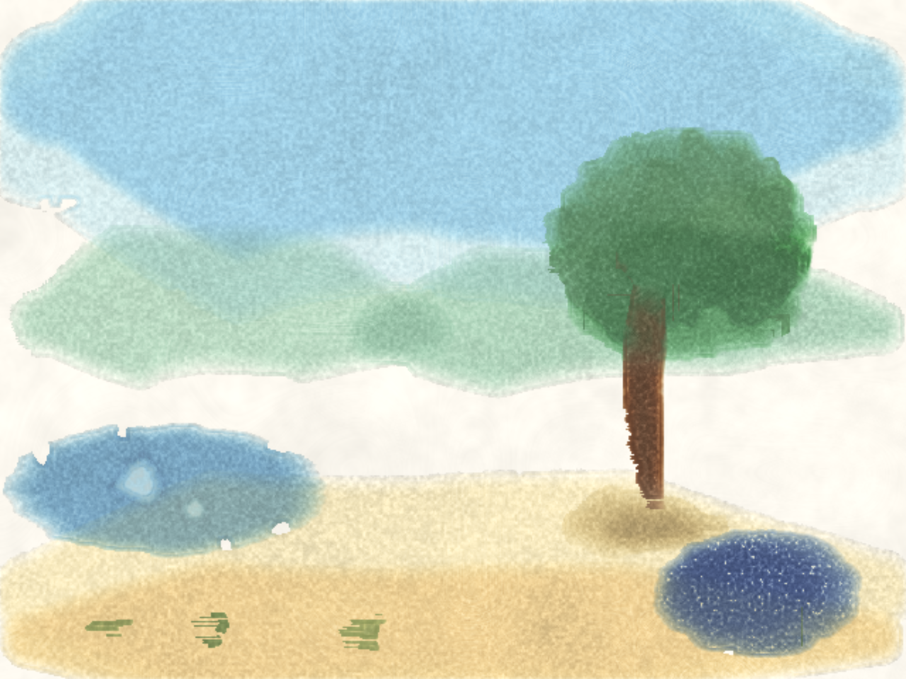

图 3　32 笔全景《树与池塘》：湿铺天空、罩染远山、干皴树冠、趁湿滴清水回流 ×2、重颗粒群青沉淀、洗色——五工件与扩展件合流，视觉评审 8.8/10。

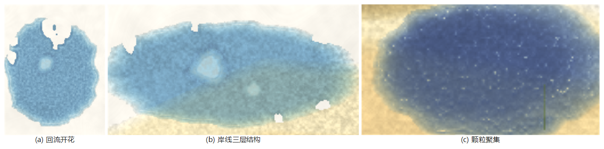

图 4　感知签名特写：(a) 回流开花——深色锯齿蕾丝环 + 浅色水渍心；(b) 岸线三层结构——深色水线 / 近岸透明带 / 外侧浅线；(c) 颗粒聚集——重颜料沉入纸谷成絮状团簇。

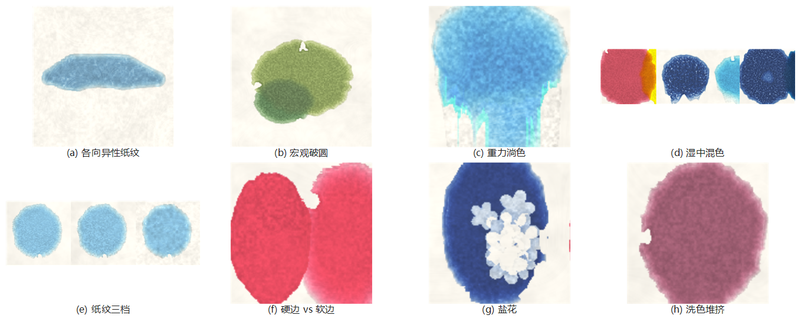

图 5　扩展技法八格：(a) 各向异性纸纹（湿铺边缘沿纤维爬行的毛边）；(b) 宏观破圆；(c) 重力淌色；(d) 湿中混色互渗与粒重分离；(e) 纸纹三档（hot/cold/rough）；(f) 硬边 vs 软边；(g) 盐花；(h) 洗色堆挤。

### 4.3 颜色系统

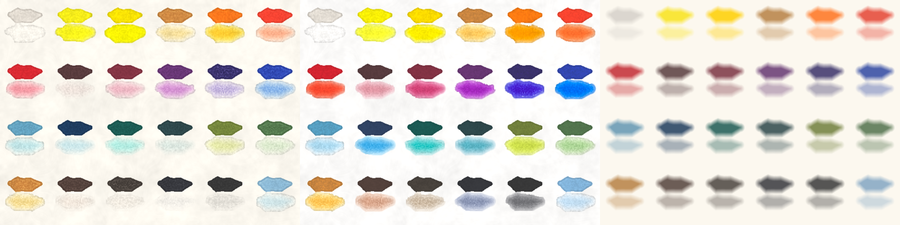

图 6　24 色卡三栏并排：左 RGB 三通道 KM，中 16 波段光谱 KM，右平涂参照。视觉评审：RGB 7.2/10 → 光谱 8.5/10（约 17–18 支可盲认）。

表 4　双颜色系统指标对照（24 色全强度）

| 指标 | RGB 三通道 KM | 16 波段光谱 KM |
|---|---|---|
| 通道数 | 3 | 16（400–700 nm / 20 nm） |
| 平均 ΔE（全强度 24 色） | 5.5 | **3.2** |
| 朱红 / 大红 / 玫瑰红 ΔE | 6.5 / 8.4 / 10.9 | **1.9 / 1.9 / 3.9** |
| 色卡视觉评分 | 7.2/10 | **8.5/10** |
| 集成调参轮（浓档 ΔE00 / 淡档 \|ΔH\|） | — | **2.0 / 3.1°** |

### 4.4 与 Open-Watercolor-Sim 的对照

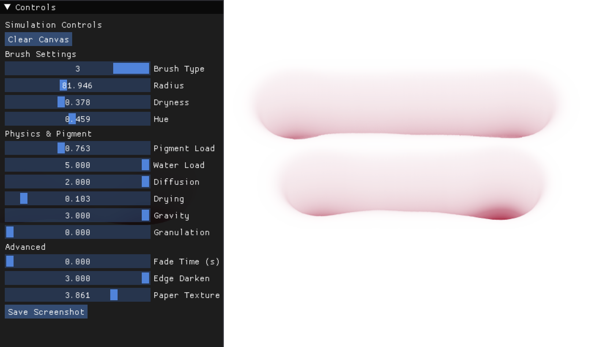

图 7　对照基准 Open-Watercolor-Sim 官方 demo（Taichi GPU 内核）与调参面板。视觉评审 2.5/10（"带颜色的雾"）；我方调参极限版 3.0/10；cauliflower 四象限参数实验证实回流机制结构性缺失。

表 5　vision 独立评审评分轨迹（"这水是真的" 0–10）

| 对象 | 分数 | 备注 |
|---|---|---|
| OWS 官方 demo（对照） | 2.5 | "带颜色的雾" |
| OWS 我方调参极限版 | 3.0 | 参数救不了内核 |
| 本引擎全景（历次） | 2.0 → 3.0 → 4.5 → 5.0 → 6.0–6.5 | 背景湿铺 8 分，物体笔触 4–5 分 |
| 本引擎全景（M1–M5 升级后） | 7.5 → 8.5 → **8.8** | M5 混色轮 8.8 全场新高 |
| 回流开花特写 | 4.0 → 4.5 → 6.0 → **6.5–7.0** | 闭环蕾丝 + 浅心成立 |
| 24 色卡 RGB → 光谱 | 7.2 → **8.5** | 约 17–18 支可盲认 |

---

## 5 案例研究：两条作画序列

### 5.1 案例一《三个柿子》：意图层书写的自主静物

本案例验证"模型只写 stroke 协议、引擎只渲染水"的分工：75 笔静物全部由意图层以协议书写（cover 1 / glaze 41 / wet-wash 8 / dry-brush 9 / lift 16），共 7630 模拟步。作画过程是多轮"画—看—批—改"的闭环：v3 评审指出"果实悬浮"，随后接触点压暗、每果左上软高光、蒂改四裂扁帽；v7 纸色修补（lift 提掉三处溢色晕）；v9 收官（强 lift 提净残余晕 + 投影贴底 + 冷灰交界）；v11 终版（先强 lift 提掉残黄再背景罩平——透明罩染压不住底层，这一作画顺序本身是水彩常识在协议层的体现）。

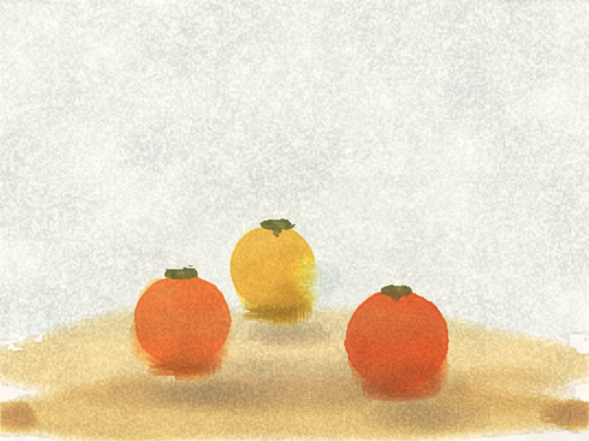

图 8　《三个柿子》定稿：三个橙红果实 + 橄榄褐蒂，群影右移配合左上光源，反光带贴剪影内，桌面湿铺与背景罩染完成。

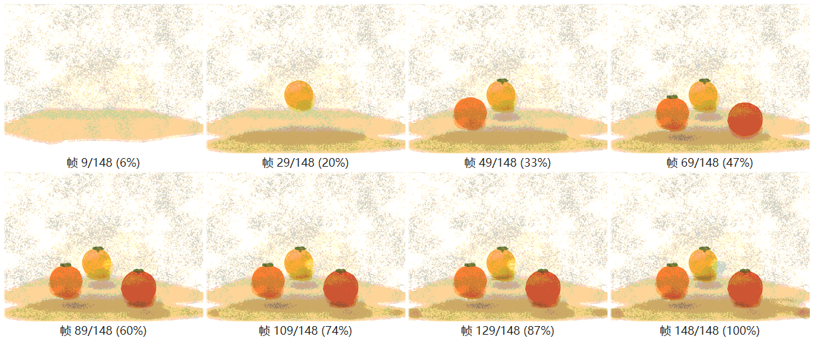

图 9　《三个柿子》作画序列：自左上至右下按时间推进（约 6% → 100%）。注意湿铺晕开、干燥中投影逐渐固着、lift 修补后纸面恢复——这些中间态在静态生成器中不存在。

### 5.2 案例二《乡村田野》：83 笔临摹的笔序分解

本案例验证协议的完整性与笔序的可读性：以一幅乡村田野为参照（图 10a），意图层将其分解为 83 笔（cover 23 / poly 8 / wet-wash 6 / glaze 6 / dry-brush 25 / spatter 7 / lift 8），共 6740 模拟步。笔序遵循水彩的经典次序：整片连续蓝洗天空（上深下浅）→ lift 负形云 → 通长树带 → 麦田底色（近浓远淡）→ 房屋（山墙五边形 + 透视正确的双坡顶 + 瓦线与脊线 + 蓝廊栏）→ 石墙 spatter → 带茎麦穗与橙黄点簇 → 雏菊 → 前景三色弧形尖叶草带 → 收尾负形云。新增的 `poly` 多边形原语为屋顶、窗、墙这类硬边形体服务，与 soft 湿铺形成硬/软双通道。

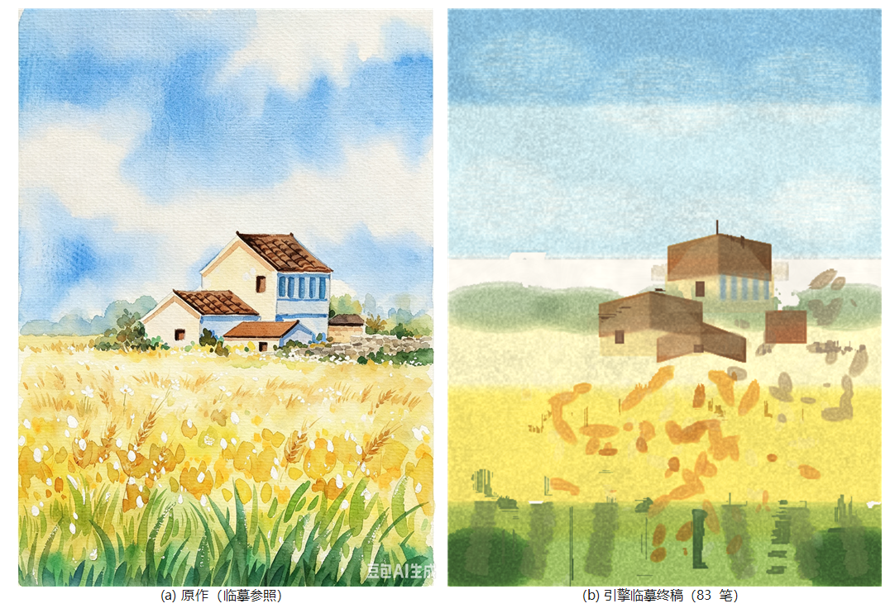

图 10　《乡村田野》：(a) 参照图（1728×2304）；(b) 引擎临摹终稿（83 笔，2× 渲染 960×1280）。

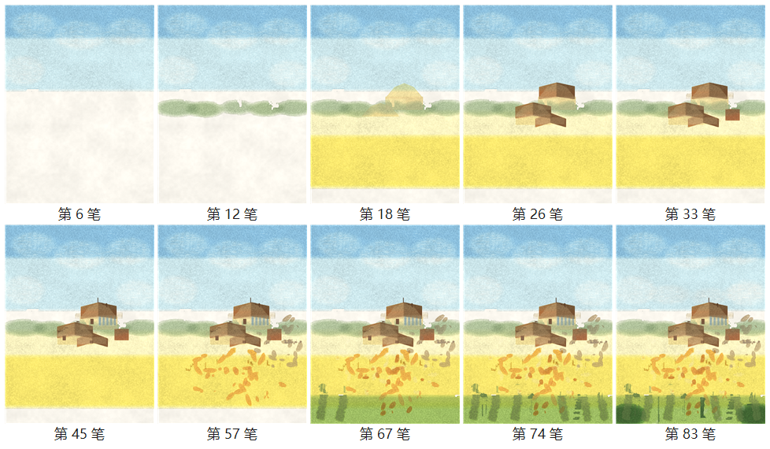

图 11　《乡村田野》笔序序列：第 6 笔（天空 + 负形云）→ 第 12 笔（树带）→ 第 18 笔（房屋起形，首个多边形山墙）→ 第 26 笔（双坡顶成形）→ 第 33 笔（瓦线与脊线）→ 第 45 笔（蓝廊栏完成）→ 第 57 笔（麦田橙黄点簇）→ 第 67 / 74 笔（前景草带三色尖叶）→ 第 83 笔（收尾负形云）。

诚实说明：与参照图相比，临摹稿在细节密度与精致度上仍有差距（评审评语"schematic and coarse"），差距主要在物体笔触品味——这是引擎正确渲染了笔触、而笔触本身的设计（半径分布、方向、飞白密度）尚停留在"印章"水平的直接证据，属意图层/agent 层的活，而非介质层缺陷（§6.1）。

### 5.3 干燥时间线：过程即产品

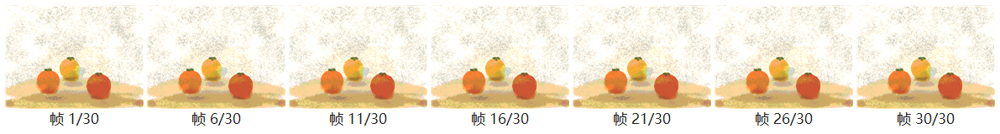

图 12　干燥时间线：落笔结束后画布继续蒸发 900 步（~15 s 模拟时间）。左至右可见湿区收缩、边缘先干、水痕逐渐"长出来"。这是区别于"笔刷滤镜"的护城河：观众看到的是时间流逝本身，而不是几张图的轮播。

表 6　两条案例序列统计

| 案例 | 画布网格 | 笔数 | 作画步数 + 干燥步数 | 主要笔触构成 | 序列资产 |
|---|---|---|---|---|---|
| 《三个柿子》 | 640×480 | 75 | 6730 + 900 | glaze 41 · lift 16 · dry-brush 9 | 终稿 PNG + 148 帧作画 GIF + 30 帧干燥 GIF |
| 《乡村田野》 | 480×640 | 83 | 6040 + 700 | dry-brush 25 · cover 23 · poly 8 · spatter 7 | 逐笔快照 83 张 + 168 帧作画 GIF + 20 帧干燥 GIF |

---

## 6 讨论

### 6.1 诚实评估：什么成立、什么还差

成立的部分：**"水是真的"已过大半**——缩略图一眼是松散水彩小品，水痕会自己长出来；色彩"准"已足（光谱系统平均 ΔE 3.2，色卡 8.5/10），离"艳 / 深 / 身份"的目标尚有一档。仍差的部分集中在三处：物体笔触品味（4–5 分水平，§5.2 已示证据）、bloom 瓣形与雷同度（known issue）、granulation 与纸纤维方向的绑定。这些差距的归因是明确的：**介质层正确渲染了它收到的笔触，问题出在笔触的设计**——这正是 Phase 1 意图层 + 眼睛层的活，而不是再往引擎里堆效果。

### 6.2 局限

1. **单质量通道**：无颜料密度分离、无解吸（re-wet 重溶是近似搬运），粒重分离靠 M5 物性字段的平流滞后近似；
2. **granulation 是灰阶阴影**，缺"纸谷 fleck 的色相身份"；
3. **时域相干**：扩散 + 离散采样的帧间跳变是固有产物（Bousseau 的警示），Phase 2 时间线产品化需正视；
4. **光谱是程序化近似**：24 支颜料光谱按家族立形拟合，非实测数据——接口只要求 16 波段反射率，将来可无缝替换实测光谱；
5. **评测的单一性**：vision 评审虽独立于开发者，但仍是单一模型的主观判断，缺少多人盲评与画家基准。

### 6.3 感知签名方法论的边界

本文方法的适用条件值得显式声明：感知签名路线在"观众认签名而非方程"的尺度上成立（Fresco/Procreate 已商业验证），但当观众是画家本人、或尺度放大到 8K 特写时，签名与物理的差距会重新显现。因此我们把全物理 NS 模拟、纸纤维微观建模明确列为非目标，同时以分层架构保留"签名 → 物理"的逐件替换通道（如程序化光谱 → 实测光谱）。

### 6.4 未来工作

按 roadmap：**Phase 1**——意图层（笔序规划、技法知识）、眼睛层（局部批评、多候选选一）与胶水层（阶段预算、keep-best、日志即证据链）接入，实现"一句话到完整水彩"的端到端；**time 层**——录制/回放/暂停/重渲染（护城河层）；**成长层**——作品集、风格形成与品味校准（"第 100 张画和第 1 张画的区别"，成本最低、最易被无限推迟，建议 Phase 1 末排队）。品味观遵循项目既定裁决：品味不是生成器的属性而是数据，人是唯一神谕。

---

## 7 结论

本文给出了一个三权分立的自主水彩绘画系统：意图（LLM）、介质（感知签名引擎）、时间（干燥时间线）与眼睛（vision 批评）四个角色经 stroke 协议闭环协作，站进了"过程可见 + 介质真实 + 自主创作"的空象限。介质引擎以纯 JS、零依赖实现九步管线与五个感知签名，经 M1–M5 升级与 KM/光谱两次颜色革命，全景视觉评分从 2.0 走到 8.8，24 色平均 ΔE 从 5.5 降至 3.2，并显著优于开源对照基准。两条完整的作画序列——《三个柿子》（75 笔自主创作）与《乡村田野》（83 笔临摹）——证明了协议 → 引擎 → 批评 → 改笔的闭环可行，且作画过程本身成为可观看、可回放、可提问的产品。下一步是把意图层与眼睛层接入闭环，让"一句话到一幅完整水彩"成为日常操作，同时把时间线做深——因为水彩的美是时间函数，时间线不是加分项，是护城河。

---

## 参考文献

[1] Curtis, C. J., Anderson, S. E., Seims, J. E., Fleischer, K. W., Salesin, D. H. Computer-Generated Watercolor. *Proceedings of SIGGRAPH 1997*, pp. 421–430. 1997.

[2] Curtis, C. J., Anderson, S. E., Seims, J. E., Fleischer, K. W., Salesin, D. H. Computer Generated Watercolor. U.S. Patent 6,198,489. 2001.

[3] Small, D. Simulating watercolor by modeling diffusion, pigment, and paper fibers. *Proc. SPIE 1460, Image Handling and Reproduction Systems Integration*. 1991.

[4] Deegan, R. D., Bakajin, O., Dupont, T. F., Huber, G., Nagel, S. R., Witten, T. A. Capillary flow as the cause of ring stains from dried liquid drops. *Nature* 389: 827–829. 1997.

[5] Chu, N. S.-H., Tai, C.-L. MoXi: Real-Time Ink Dispersion in Absorbent Paper. *ACM SIGGRAPH 2005 Sketches*. 2005.

[6] Bousseau, A., Kaplan, M., Thollot, J., Sillion, F. X. Interactive watercolor rendering with temporal coherence and abstraction. *Proc. NPAR 2006*, pp. 141–149. 2006.

[7] Bousseau, A., Neyret, F., Thollot, J., Salesin, D. Video watercolorization using bidirectional texture advection. *ACM Transactions on Graphics* 26(3). 2007.

[8] Montesdeoca, S. E., Seah, H. S., Rall, H.-M. Edge- and substrate-based effects for watercolor stylization. *Proc. NPAR 2017*. 2017.

[9] Montesdeoca, S. E., et al. Art-directed watercolor stylization of 3D animations in real-time. *Computers & Graphics* 65: 60–72. 2017.

[10] Chen, Z., Kim, B., Ito, D., Wang, H. Wetbrush: GPU-based 3D painting simulation at the bristle level. *ACM Transactions on Graphics (SIGGRAPH Asia 2015)* 34(6). 2015.

[11] DiVerdi, S., Krishnaswamy, A., Mech, R., Ito, D. Industrial-strength painting with a virtual bristle brush. *Proc. VRST 2010*. 2010.

[12] Zheng, M., Milliez, A., Gross, M., Sumner, R. W. Example-Based Brushes for Coherent Stylized Renderings. *Proc. NPAR 2017*. 2017.

[13] Hobbs, T. How to Hack a Painting. https://tylerxhobbs.com/essays/2017/how-to-hack-a-painting. 2017.

[14] Stam, J. Stable Fluids. *Proceedings of SIGGRAPH 1999*, pp. 121–128. 1999.

[15] Kubelka, P., Munk, F. Ein Beitrag zur Optik der Farbanstriche. *Zeitschrift für Technische Physik* 12: 593–601. 1931.

[16] CIE. *Commission Internationale de l'Eclairage Proceedings, 1931*. Cambridge University Press. 1932.

[17] Ho, J., Jain, A., Abbeel, P. Denoising Diffusion Probabilistic Models. *Advances in Neural Information Processing Systems (NeurIPS 2020)*. 2020.

[18] Rombach, R., Blattmann, A., Lorenz, D., Esser, P., Ommer, B. High-Resolution Image Synthesis with Latent Diffusion Models. *Proc. CVPR 2022*. 2022.

[19] watercolor-ai 项目内部文档：dsh-studio 实战教训（`docs/lessons.md`）、范式（`docs/paradigm.md`）、开发日志（`chronicle/`）。2026.

[20] Chen, S. Open-Watercolor-Sim. https://github.com/shuoqichen/Open-Watercolor-Sim. 2026.

[21] Escape Motions. Rebelle. https://www.escapemotions.com/products/rebelle. 2015–2026.

[22] Chu, N. Expresii. https://www.expresii.com. 2017–2026.

[23] Adobe. Adobe Fresco. https://www.adobe.com/products/fresco. 2019–2026.

---

## 附录 A　数据与可复现性

全部实验结果可由仓库内脚本一键复现：

```bash
node demo/render-demo.js   # 32 笔全景 → out/demo_final.png + 过程/干燥动图
node demo/agent-paint.js   # 《三个柿子》→ out/agent_still_life.png + 动图
node demo/copy-paint.js    # 《乡村田野》→ out/copy-final.png + 逐笔快照 + 动图
node demo/color-chart.js   # 24 色卡三栏
node demo/color-metrics.js # CIELAB 双系统对照
node demo/effects.js       # 8 格技法面板
node demo/showcase.js      # 能力展示集归档（out/showcase/）

# 光谱颜色系统（16 通道，慢约 2.7 倍）：
#   PowerShell: $env:COLOR_SYSTEM="spectral"; node demo/render-demo.js
```

评分轨迹、参数表、bug 清单与验收口径见仓库 `chronicle/` 与 `docs/`；对照基准探测全记录见 `probe/`；文献精读与归属核对见 `research/`。
